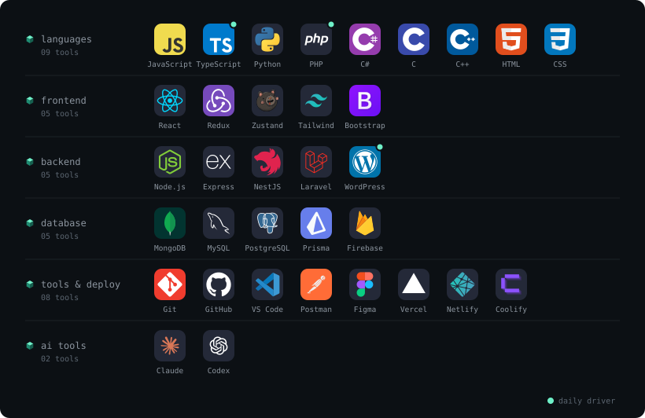

<!-- <h1 align="center">Shirajul Islam Shakur</h1> -->

<!-- 
 -->
  <!-- The banner already states the name, title and stack, so this line adds current focus instead of repeating them. -->
  <!--  -->
<!-- 
 -->

<!-- 

  
  
  
  

  

 -->

 

 

  <a href="https://github.com/Bit-Apps-Pro">@Bit-Apps-Pro</a> &nbsp;·&nbsp; <a href="mailto:shiirajullisllam@gmail.com">shiirajullisllam@gmail.com</a>

 

<!-- Generated by scripts/readme-art.mjs: edit STACK there and re-run to change it. -->

 

  <!-- Built daily by .github/workflows/contribution-city.yml. Swap city-teal for city-green or city-blue to change the colours. -->
  

  

<!-- Activity graph service returns 402 (out of free hosting usage); restore if it comes back.

  

 -->
