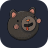
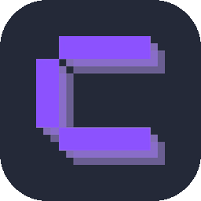

<!-- <h1 align="center">Shirajul Islam Shakur</h1> -->

<!-- <p align="center"> -->
  <!-- The banner already states the name, title and stack, so this line adds current focus instead of repeating them. -->
  <!--  -->
<!-- </p> -->

<!-- <p align="center">
  <a href="https://shakurshirajul.com">
    
  </a>
  <a href="https://www.linkedin.com/in/shakur-shirajul">
    
  </a>
  <a href="https://codeforces.com/profile/Shakur">
    
  </a>
  <a href="mailto:shiirajullisllam@gmail.com">
    
  </a>
</p>

<p align="center">
  
</p> -->

<br />

## 🧑‍💻 About Me

I'm a full-stack developer from Bangladesh who builds dynamic web applications with the **MERN stack** and **PHP Laravel**. These days I write a lot of TypeScript and PHP, building WordPress plugins at **[@Bit-Apps-Pro](https://github.com/Bit-Apps-Pro)**.

I like work that starts messy and ends obvious taking a tangled problem, finding the clean shape underneath it, and building that properly.

```js
const shakur = {
  role: "Full-Stack Developer",
  stack: ["React", "Node.js", "Express", "MongoDB", "Laravel", "MySQL"],
  daily: ["TypeScript", "PHP", "WordPress Plugins"],
  offDuty: ["Gaming"],
  mantra: "Learn it, build it, ship it, repeat.",
};
```

<br />

## 🚀 What I'm Up To

- 🔭 &nbsp;Building WordPress plugins with **TypeScript** and **PHP** at **[@Bit-Apps-Pro](https://github.com/Bit-Apps-Pro)**
- 🌱 &nbsp;Going deeper on **PHP Laravel** and backend architecture
- 🧰 &nbsp;Working with **Postgres**, **Prisma** and **Coolify** on the infrastructure side
- 💬 &nbsp;Happy to talk about **JavaScript, React, Laravel** or anything MERN
- 📫 &nbsp;Reach me at **shiirajullisllam@gmail.com**
- 🎮 &nbsp;Off the clock, you'll find me gaming

<br />

## 🛠️ Tech Stack

<table align="center">
  <tr>
    <td align="right"><b>Languages</b></td>
    <td>
      
    </td>
  </tr>
  <tr>
    <td align="right"><b>Frontend</b></td>
    <td>
      
      <!-- Zustand has no skill-icons entry, so this is the logo on a matching #242938 rx=60 tile -->
      
    </td>
  </tr>
  <tr>
    <td align="right"><b>Backend</b></td>
    <td>
      
    </td>
  </tr>
  <tr>
    <td align="right"><b>Database</b></td>
    <td>
      
    </td>
  </tr>
  <tr>
    <td align="right"><b>Tools &amp; Deploy</b></td>
    <td>
      
      <!-- Coolify has no skill-icons entry either; same tile treatment -->
      
    </td>
  </tr>
</table>

<br />

## 📊 GitHub Stats

<div align="center">
  <!-- Built daily by .github/workflows/contribution-city.yml. Swap city-teal for city-green or city-blue to change the colours. -->
  
</div>

<div align="center">
  
</div>

<!-- Activity graph service returns 402 (out of free hosting usage); restore if it comes back.
<div align="center">
  
</div> -->

<br />

## 🏆 Featured Projects

<table>
  <tr>
    <td width="33%" valign="top">
      <h3 align="center">Craftopia</h3>
      <p align="center">A platform for showcasing creative art and crafts, built to inspire creators.</p>
      <p align="center">
        <a href="https://github.com/shakurShirajul/craftopia-client">
          
        </a>
      </p>
    </td>
    <td width="33%" valign="top">
      <h3 align="center">Textify</h3>
      <p align="center">A dynamic blogging platform with an intuitive interface for writing and sharing.</p>
      <p align="center">
        <a href="https://github.com/shakurShirajul/textify-client">
          
        </a>
      </p>
    </td>
    <td width="33%" valign="top">
      <h3 align="center">Urban Dwell</h3>
      <p align="center">A building management system for exploring properties and managing agreements.</p>
      <p align="center">
        <a href="https://github.com/shakurShirajul/urban-dwell-client">
          
        </a>
      </p>
    </td>
  </tr>
</table>

<br />

<p align="center">
  <i>Thanks for stopping by — let's build something.</i>
</p>


